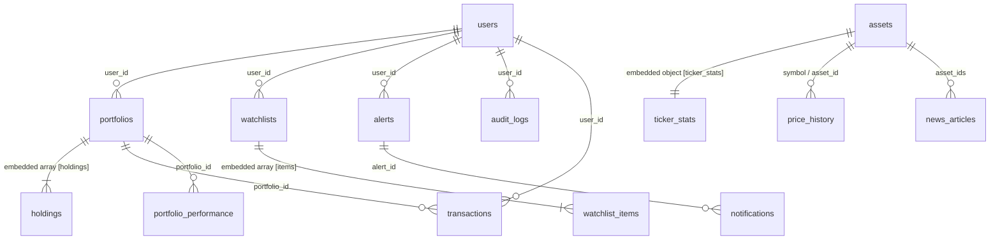

# MongoDB Document Database Schema Specification

> **Format**: Machine-readable JSON Schema (Draft 2020-12) & Entity Specifications  
> **Source File**: [`schema.json`](file:///c:/Documents/project/schema.json)  
> **Database Engine**: MongoDB / Motor Async  

---

## 1. Schema Topology & Entity Relationships



---

## 2. Collection Definitions

```yaml
database: portfolio_management
collections:
  users:
    description: "User identity, credentials, and currency settings."
    pk: "_id (ObjectId)"
    fields:
      _id: { type: "ObjectId", required: true }
      email: { type: "String", format: "email", required: true, unique: true }
      password_hash: { type: "String", required: true, format: "bcrypt" }
      base_currency: { type: "String", required: true, default: "USD" }
      created_at: { type: "Date", required: true, timezone: "UTC" }
    indexes:
      - { fields: { email: 1 }, unique: true }

  portfolios:
    description: "User portfolios with embedded asset holdings."
    pk: "_id (ObjectId)"
    fields:
      _id: { type: "ObjectId", required: true }
      user_id: { type: "String", required: true, fk: "users._id" }
      name: { type: "String", required: true, minLength: 1, maxLength: 100 }
      created_at: { type: "Date", required: true, timezone: "UTC" }
      holdings:
        type: "Array<Object>"
        description: "Embedded asset positions"
        schema:
          _id: { type: "String", required: true, format: "ObjectId" }
          symbol: { type: "String", required: true, uppercase: true }
          name: { type: "String", required: true }
          type: { type: "String", required: true, enum: ["crypto", "stock"] }
          quantity: { type: "Double", required: true, gt: 0 }
          average_buy_price: { type: "Double", required: true, ge: 0 }
          asset_id: { type: "String", required: false, fk: "assets._id" }
          updated_at: { type: "Date", required: true, timezone: "UTC" }
    indexes:
      - { fields: { user_id: 1 } }

  assets:
    description: "Global asset catalog with polymorphic subtypes."
    pk: "_id (ObjectId)"
    fields:
      _id: { type: "ObjectId", required: true }
      symbol: { type: "String", required: true, unique: true, uppercase: true }
      name: { type: "String", required: true }
      type: { type: "String", required: true, enum: ["crypto", "stock"] }
      ticker_stats:
        type: "Object"
        required: false
        schema:
          price_per_unit: { type: "Double", required: false }
          volume_24h: { type: "Double", required: false }
          high_24h: { type: "Double", required: false }
          low_24h: { type: "Double", required: false }
          updated_at: { type: "Date", required: false }
      network: { type: "String", required: false, note: "Crypto only" }
      contract_address: { type: "String", required: false, note: "Crypto only" }
      ticker_exchange: { type: "String", required: false, note: "Stock only" }
      sector: { type: "String", required: false, note: "Stock only" }
      created_at: { type: "Date", required: true, timezone: "UTC" }
    indexes:
      - { fields: { symbol: 1 }, unique: true }

  price_cache:
    description: "5-Minute TTL price cache for CoinGecko & Finnhub."
    pk: "_id (ObjectId)"
    fields:
      _id: { type: "ObjectId", required: true }
      symbol: { type: "String", required: true, uppercase: true }
      asset_type: { type: "String", required: true, enum: ["crypto", "stock"] }
      price_usd: { type: "Double", required: true }
      high_24h: { type: "Double", required: false }
      low_24h: { type: "Double", required: false }
      volume_24h: { type: "Double", required: false }
      change_24h: { type: "Double", required: false }
      fetched_at: { type: "Date", required: true, timezone: "UTC" }
      expire_at: { type: "Date", required: true, timezone: "UTC", ttl: 0 }
      metadata: { type: "Object", required: true }
    indexes:
      - { fields: { expire_at: 1 }, expireAfterSeconds: 0 }
      - { fields: { symbol: 1, asset_type: 1 } }

  transactions:
    description: "Immutable trade and transfer execution history."
    pk: "_id (ObjectId)"
    fields:
      _id: { type: "ObjectId", required: true }
      user_id: { type: "String", required: true, fk: "users._id" }
      portfolio_id: { type: "String", required: true, fk: "portfolios._id" }
      symbol: { type: "String", required: true, uppercase: true }
      asset_id: { type: "String", required: false, fk: "assets._id" }
      type: { type: "String", required: true, enum: ["BUY", "SELL", "TRANSFER_IN", "TRANSFER_OUT"] }
      quantity: { type: "Double", required: true, gt: 0 }
      price_at_transaction: { type: "Double", required: true, ge: 0 }
      network_hash: { type: "String", required: false }
      timestamp: { type: "Date", required: true, timezone: "UTC" }
    indexes:
      - { fields: { portfolio_id: 1, timestamp: -1 } }
      - { fields: { user_id: 1 } }

  portfolio_performance:
    description: "Historical valuation & gain/loss periodic snapshots."
    pk: "_id (ObjectId)"
    fields:
      _id: { type: "ObjectId", required: true }
      portfolio_id: { type: "String", required: true, fk: "portfolios._id" }
      total_value: { type: "Double", required: true }
      total_profit_loss: { type: "Double", required: true }
      total_profit_loss_pct: { type: "Double", required: true }
      timestamp: { type: "Date", required: true, timezone: "UTC" }
    indexes:
      - { fields: { portfolio_id: 1, timestamp: -1 } }

  watchlists:
    description: "User watchlists with embedded symbol tracking items."
    pk: "_id (ObjectId)"
    fields:
      _id: { type: "ObjectId", required: true }
      user_id: { type: "String", required: true, fk: "users._id" }
      name: { type: "String", required: true }
      creation_date: { type: "Date", required: true, timezone: "UTC" }
      items:
        type: "Array<Object>"
        schema:
          _id: { type: "String", required: true, format: "ObjectId" }
          symbol: { type: "String", required: true, uppercase: true }
          asset_id: { type: "String", required: false, fk: "assets._id" }
          added_at: { type: "Date", required: true, timezone: "UTC" }
    indexes:
      - { fields: { user_id: 1 } }

  alerts:
    description: "Price threshold monitoring rules."
    pk: "_id (ObjectId)"
    fields:
      _id: { type: "ObjectId", required: true }
      user_id: { type: "String", required: true, fk: "users._id" }
      symbol: { type: "String", required: true, uppercase: true }
      asset_id: { type: "String", required: false, fk: "assets._id" }
      threshold: { type: "Double", required: true, gt: 0 }
      direction: { type: "String", required: true, enum: ["ABOVE", "BELOW"] }
      enabled: { type: "Boolean", required: true, default: true }
      triggered_at: { type: "Date", required: false }
      created_at: { type: "Date", required: true, timezone: "UTC" }
    indexes:
      - { fields: { user_id: 1, enabled: 1 } }

  notifications:
    description: "Triggered alert notification records."
    pk: "_id (ObjectId)"
    fields:
      _id: { type: "ObjectId", required: true }
      alert_id: { type: "String", required: true, fk: "alerts._id" }
      user_id: { type: "String", required: true, fk: "users._id" }
      channel: { type: "String", required: true, enum: ["EMAIL", "SMS", "PUSH", "IN_APP"] }
      status: { type: "String", required: true, enum: ["PENDING", "SENT", "FAILED"] }
      sent_at: { type: "Date", required: true, timezone: "UTC" }

  exchanges:
    description: "Financial trading venues."
    pk: "_id (ObjectId)"
    fields:
      _id: { type: "ObjectId", required: true }
      name: { type: "String", required: true }
      country: { type: "String", required: true }
      url: { type: "String", required: false, format: "uri" }

  price_history:
    description: "Historical price points."
    pk: "_id (ObjectId)"
    fields:
      _id: { type: "ObjectId", required: true }
      symbol: { type: "String", required: true, uppercase: true }
      asset_id: { type: "String", required: false, fk: "assets._id" }
      price: { type: "Double", required: true }
      volume: { type: "Double", required: false }
      timestamp: { type: "Date", required: true, timezone: "UTC" }

  news_articles:
    description: "Market news tagged with relevant asset tickers."
    pk: "_id (ObjectId)"
    fields:
      _id: { type: "ObjectId", required: true }
      headline: { type: "String", required: true }
      source: { type: "String", required: true }
      url: { type: "String", required: true, format: "uri" }
      published_at: { type: "Date", required: true, timezone: "UTC" }
      asset_ids: { type: "Array<String>", required: true }

  currency_rates:
    description: "ISO currency rates relative to USD."
    pk: "_id (String)"
    fields:
      _id: { type: "String", required: true, description: "Currency code (e.g. EUR, GBP)" }
      currency_code: { type: "String", required: true }
      rate_to_usd: { type: "Double", required: true, gt: 0 }
      updated_at: { type: "Date", required: true, timezone: "UTC" }

  audit_logs:
    description: "Audit trail recording system actions for security and compliance."
    pk: "_id (ObjectId)"
    fields:
      _id: { type: "ObjectId", required: true }
      user_id: { type: "String", required: true, fk: "users._id" }
      action: { type: "String", required: true }
      timestamp: { type: "Date", required: true, timezone: "UTC" }
    indexes:
      - { fields: { user_id: 1, timestamp: -1 } }
```
