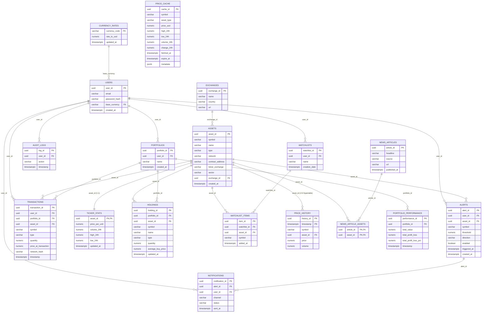

# Entity-Relationship (ER) Diagram & Relational Cardinality

The following diagram models the entire database structure of the **Live Crypto and Stock Analysis Platform**, capturing all 18 tables, their primary keys, foreign keys, cardinality, and the hypertable relationship between `assets` and `price_history`.

---

## Relational Cardinality and Integrity Matrix

| Relationship | Cardinality | Enforced By | Business Rule |
| :--- | :---: | :--- | :--- |
| `currency_rates` $\to$ `users` | $1 : N$ | `fk_users_currency` ON UPDATE CASCADE | Every user selects an active base currency. Exchange rate changes propagate automatically. |
| `users` $\to$ `portfolios` | $1 : N$ | `fk_portfolios_user` ON DELETE CASCADE | A user can own multiple distinct portfolios (e.g., Growth, Cold Storage). |
| `portfolios` $\to$ `holdings` | $1 : N$ | `fk_holdings_portfolio` ON DELETE CASCADE | Portfolios contain zero or more current asset positions. |
| `portfolios` $\times$ `symbol` | $1 : 1$ | `uq_portfolio_symbol` UNIQUE Constraint | Each symbol appears at most once per portfolio with aggregated weighted-average cost. |
| `portfolios` $\to$ `transactions` | $1 : N$ | `fk_tx_portfolio` ON DELETE CASCADE | Immutable audit history of all trades conducted in the portfolio. |
| `portfolios` $\to$ `portfolio_performance` | $1 : N$ | `fk_perf_portfolio` ON DELETE CASCADE | Chronological time-series snapshots of portfolio valuation over time. |
| `users` $\to$ `watchlists` | $1 : N$ | `fk_watchlists_user` ON DELETE CASCADE | Users can configure custom asset monitor lists. |
| `watchlists` $\to$ `watchlist_items` | $1 : N$ | `fk_wl_items_watchlist` ON DELETE CASCADE | Watchlists contain tracked asset items (`uq_watchlist_symbol`). |
| `users` $\to$ `alerts` | $1 : N$ | `fk_alerts_user` ON DELETE CASCADE | Users register price notification rules. |
| `alerts` $\to$ `notifications` | $1 : N$ | `fk_notif_alert` ON DELETE CASCADE | When an alert triggers, one or more notification logs are dispatched. |
| `assets` $\to$ `ticker_stats` | $1 : 1$ | `fk_ticker_stats_asset` ON DELETE CASCADE | Each catalog asset has exactly one current 24-hour summary record. |
| `assets` $\to$ `price_history` | $1 : N$ | `fk_history_asset` ON DELETE SET NULL | High-frequency time-series observations partitioned into TimescaleDB chunks. |
| `news_articles` $\leftrightarrow$ `assets` | $M : N$ | `news_article_assets` composite PK | Articles can relate to multiple assets, and assets can be cited in multiple articles. |
| `price_cache` | Standalone | `uq_cache_symbol_type` | Ephemeral caching layer with expiration timestamps (`expire_at`). |
| `users` $\to$ `audit_logs` | $1 : N$ | `fk_audit_user` ON DELETE CASCADE | Compliance trail for regulatory tracking and trade transparency. |
